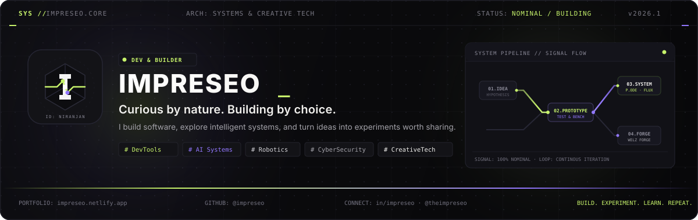
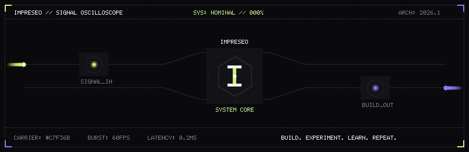
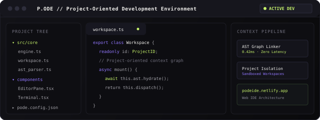
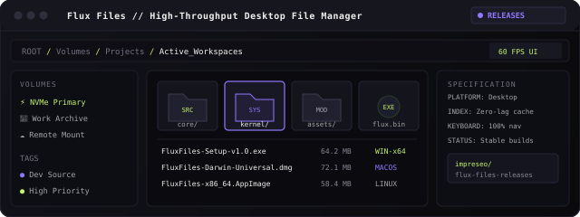
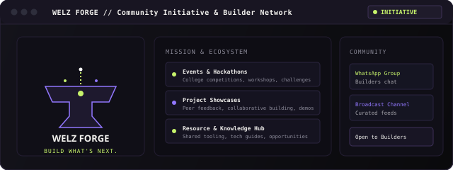
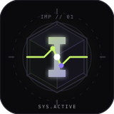

<div align="center">

<picture>
  <source media="(prefers-color-scheme: dark)" srcset="assets/impreseo-hero.svg">
  <source media="(prefers-color-scheme: light)" srcset="assets/impreseo-hero.svg">
  
</picture>

<br>

<p align="center">
  <b>Personal Brand:</b> IMPRESEO &nbsp;·&nbsp;
  <b>Name:</b> Niranjan &nbsp;·&nbsp;
  <b>Focus:</b> Software Engineering · Intelligent Systems · Robotics · Creative Tech
</p>

<p align="center">
  <a href="https://impreseo.netlify.app/"></a>
  <a href="https://github.com/impreseo"></a>
  <a href="https://in.linkedin.com/in/impreseo"></a>
  <a href="https://x.com/theimpreseo"></a>
  <a href="https://www.youtube.com/@theimpreseo"></a>
  <a href="https://www.instagram.com/theimpreseo/"></a>
  <a href="mailto:theimpreseo@gmail.com"></a>
</p>

<br>

<picture>
  <source media="(prefers-color-scheme: dark)" srcset="assets/impreseo-signal.gif">
  <source media="(prefers-color-scheme: light)" srcset="assets/impreseo-signal.gif">
  
</picture>

</div>

---

### `01 // INCEPTION` &mdash; About Me

Hi, I'm **Niranjan** (building as **IMPRESEO**). 

I am a developer, technology enthusiast, builder, and creative problem-solver. I love exploring computing from first principles: writing developer tools that feel snappy, experimenting with intelligent agent architectures, wiring sensors into microcontrollers, and designing technical interfaces with clean visual feedback.

Rather than sticking to a single silo, I work at the intersection of:
- **Developer Tooling & Workspaces:** Crafting environments that accelerate building.
- **Intelligent Systems & AI:** Prototyping contextual pipelines and agent workflows.
- **Robotics & Hardware:** Tinkering with automation, sensors, and telemetry.
- **Cybersecurity & Systems:** Studying zero-trust principles and OS fundamentals.
- **Creative Technology:** Bringing motion, geometric clarity, and tactile ergonomics to digital tools.

My philosophy is straightforward: **learn by building, benchmark in public, and share useful work.**

---

### `02 // SIGNALS` &mdash; What I'm Exploring

```
┌─────────────────────────┬────────────────────────────────────────────────────────┐
│ DOMAIN                  │ CORE INVESTIGATIONS                                    │
├─────────────────────────┼────────────────────────────────────────────────────────┤
│ Developer Tooling       │ AST parsing, context trees, high-throughput interfaces  │
│ AI & Intelligent Systems│ Local LLM runtime agents, memory buffers, tool dispatch │
│ Robotics & Automation   │ Embedded microcontrollers, motor telemetry, sensor bus │
│ Systems & Security      │ Sandboxed execution, zero-trust token flows, POSIX CLI │
│ Creative Technology     │ Generative vector geometry, fluid interaction, shaders │
└─────────────────────────┴────────────────────────────────────────────────────────┘
```

---

### `03 // BUILDS` &mdash; Featured Projects

#### 1. P.ODE &mdash; Project-Oriented Development Environment
> **Status:** Active Development &nbsp;·&nbsp; **Platform:** Web / IDE &nbsp;·&nbsp; **Live:** [podeide.netlify.app](https://podeide.netlify.app/)

A project-oriented web development environment engineered to eliminate workspace friction. Designed with contextual file graph hydration, modular editor panes, and zero-latency AST parsing to keep builders in flow state.

<p align="center">
  
</p>

- **Core focus:** Workspace context mapping, keyboard-first navigation, low-overhead editor architecture.
- **Tech stack:** TypeScript, Web APIs, Component Architecture, Reactive State.

---

#### 2. Flux Files &mdash; High-Throughput Desktop File Manager
> **Status:** Pre-Release Builds &nbsp;·&nbsp; **Platform:** Cross-Platform Desktop &nbsp;·&nbsp; **Releases:** [github.com/impreseo/flux-files-releases](https://github.com/impreseo/flux-files-releases)

A modern desktop file manager built for speed, keyboard navigation, and clutter-free filesystem exploration across Windows, macOS, and Linux.

<p align="center">
  
</p>

- **Core focus:** Instant directory indexing, responsive multi-tab layouts, low-overhead system call bridges.
- **Packaging:** Multi-architecture releases (`.exe`, `.dmg`, `.AppImage`).

---

#### 3. WELZ Forge &mdash; Build What’s Next
> **Status:** Community Initiative &nbsp;·&nbsp; **Mission:** Student & Builder Empowerment &nbsp;·&nbsp; **Community:** [WhatsApp Group](https://chat.whatsapp.com/FGAj6T0VZP7IFzJtUztzvE) &nbsp;·&nbsp; [WhatsApp Channel](https://whatsapp.com/channel/0029Vb8kfooDjiOXB9YzHb1Z)

An early-stage builder community initiative created to connect ambitious students, developers, and makers. WELZ Forge bridges the gap between ideas and real-world execution by curating hackathons, college competitions, workshops, and peer project showcases.

<p align="center">
  
</p>

- **Core focus:** Hackathon discovery, technical workshops, project feedback, and builder collaboration.

---

#### 4. Prototypes & Research Concepts

Here are exploratory prototypes and concept architectures from my lab notes:

| Project | Category | Current Status | Architecture Note |
| :--- | :--- | :--- | :--- |
| **AegisID** | Security / Auth | *Prototype* | Cryptographic identity verification and hardware token handshake experiments. |
| **VaultPay** | Systems / Fintech | *Concept Design* | Low-latency settlement state machine and transaction integrity protocol. |
| **DronVision Pro** | Robotics / CV | *Experiment* | Real-time computer vision telemetry pipeline for object tracking. |
| **Condage Fabric** | Infrastructure | *Concept Spec* | Zero-trust authentication fabric designed for distributed services. |
| **Tagoryx** | Developer Tools | *Prototype* | Fast local tagging and metadata clustering engine for unstructured files. |
| **LANDSTACK** | Architecture | *Research* | Modular spatial computing and asset layout experiment. |
| **VyaparX** | Commerce Tech | *Exploration* | Lightweight micro-commerce and ledger synchronization framework. |

---

### `04 // TOOLKIT` &mdash; Technologies & Tools

I choose tools based on the problem at hand, prioritizing predictability, speed, and ergonomics:

- **Languages:** `TypeScript`, `JavaScript (ESNext)`, `Python`, `HTML5 / CSS3`, `SQL`, `C / C++ (Embedded)`
- **Frontend & UI Systems:** `React`, `Vite`, `Tailwind CSS`, `Motion`, `Next.js`
- **Runtimes & Desktop:** `Node.js`, `Electron`, `Express`, `POSIX Shell / Bash`
- **Graphics & Creative:** `Three.js`, `Canvas API`, `SVG Vector Math`, `Figma`
- **Environment & Automation:** `Git`, `GitHub Actions`, `Linux`, `Docker`, `ESP32 / Arduino`

---

### `05 // TELEMETRY` &mdash; GitHub Signal

---

### `06 // METHODOLOGY` &mdash; How I Build

1. **Deconstruct to first principles:** Understand the machine, the data flow, and the human using it.
2. **Prototype rapidly:** Build a working vertical slice before writing endless documentation.
3. **Refine ruthlessly:** Remove clutter, tighten latency, polish typography, and test edge cases.
4. **Ship & document:** Working software beats theoretical speculation every time.

---

### `07 // CHANNELS` &mdash; Connect With Me

Whether you want to collaborate on an open-source project, discuss AI systems, or connect through the builder community, reach out:

| Channel | Destination | Primary Use |
| :--- | :--- | :--- |
| **Portfolio** | [impreseo.netlify.app](https://impreseo.netlify.app/) | Interactive showcases & case studies |
| **GitHub** | [@impreseo](https://github.com/impreseo) | Codebases, repositories, and releases |
| **LinkedIn** | [in/impreseo](https://in.linkedin.com/in/impreseo) | Professional updates & networking |
| **X (Twitter)** | [@theimpreseo](https://x.com/theimpreseo) | Quick thoughts, build logs, and tech experiments |
| **YouTube** | [@theimpreseo](https://www.youtube.com/@theimpreseo) | Demos, tutorials, and deep-dives |
| **Instagram** | [@theimpreseo](https://www.instagram.com/theimpreseo/) | Visual design and hardware updates |
| **Email** | [theimpreseo@gmail.com](mailto:theimpreseo@gmail.com) | Direct correspondence |

---

<div align="center">



<br>

```
[ IMPRESEO // SYSTEM TERMINAL ]
BUILD. EXPERIMENT. LEARN. REPEAT.
```

<p align="center">
  <sub>Crafted with deliberate engineering and vector art for Niranjan (@impreseo).</sub>
</p>

</div>
